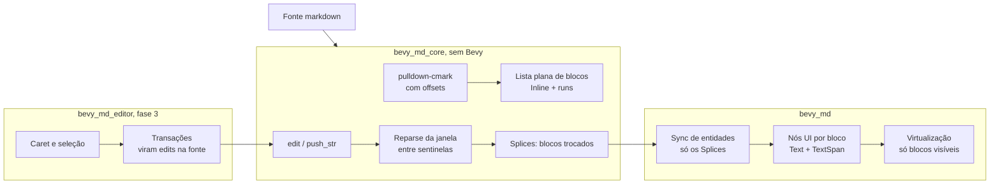

# bevy_md: plano

Markdown nativo para Bevy, open source, 100% Rust, com performance absurda.
Primeiro um renderer de streaming, depois um editor com a experiência do Notion.

## 1. Objetivo

1. **Viewer:** renderizar markdown no Bevy UI, incluindo texto que chega em
   streaming (resposta de IA), sem custo proporcional ao tamanho do documento.
2. **Editor:** edição direta no texto renderizado, estilo Notion: blocos,
   menu `/`, regras de digitação (`# ` vira título), arrastar blocos, toolbar
   flutuante, `[[wikilinks]]`.
3. **Ecossistema:** crates publicados no crates.io que outras pessoas usem em
   jogos e apps Bevy, e que o Tessel use para notas e chat.

### Princípios

- **Custo proporcional à mudança, nunca ao documento.** Vale para parse,
  ECS, layout de texto e GPU.
- **Núcleo sem engine.** `bevy_md_core` não depende do Bevy. Testa rápido,
  compila rápido e serve a qualquer renderer.
- **Correção verificável.** Todo atalho incremental tem um teste que o
  compara com o caminho completo.
- **Orçamentos medidos.** Cada meta de performance tem um benchmark e uma
  checagem no CI.

## 2. O que já existe

| Peça | Estado |
|---|---|
| Workspace Cargo, toolchain 1.99.1, licença MIT/Apache, CI | pronto |
| `bevy_md_core`: blocos planos, runs de estilo, tabelas, tarefas, front matter | pronto |
| Edição incremental (`edit`, `push_str`, `set_source`) que devolve `Splices`, a lista de trocas disjuntas | pronto |
| Teste de propriedade: milhares de edições aleatórias iguais a um parse completo | pronto |
| Benchmarks criterion: parse de 1 MB, tecla em 1 MB, streaming | pronto |
| `bevy_md`: `MarkdownPlugin`, componente `Markdown`, tema, sync só dos blocos afetados | mínimo |
| Exemplo `streaming` (texto chegando alguns bytes por frame) | pronto |

### Primeiros números (M-series, release)

| Medida | Hoje | Meta |
|---|---|---|
| Parse completo de 1 MB | ~26 ms (37 MiB/s) | < 15 ms |
| Uma tecla no meio de um doc de 1 MB | ~270 µs | < 20 µs |
| Doc de 800 B em chunks de 32 B (streaming) | ~97 µs no total | < 40 µs |
| Doc de 800 B em chunks de 4 B | ~650 µs no total | < 150 µs |

Os 270 µs da tecla vêm quase todos do deslocamento dos offsets de todos os
blocos depois da edição (O(n)). O plano para isso está na seção 5.

## 3. Arquitetura



### Crates

| Crate | Depende de | Papel |
|---|---|---|
| `bevy_md_core` | pulldown-cmark | Modelo de blocos, parse incremental, source map |
| `bevy_md` | core, Bevy | Plugin, render, tema, virtualização, links, imagens |
| `bevy_md_highlight` | core, tree-sitter | Realce de código fora da thread principal (feature opcional) |
| `bevy_md_editor` | core, bevy_md | Caret, seleção, IME, undo, UX Notion |

### Modelo de dados

- **Fonte:** uma `String` com o markdown. É a fonte da verdade no viewer e no
  editor (decisão D3).
- **Bloco:** `kind`, `content: Inline`, `span` (bytes da fonte), `root` (o
  construto de topo a que pertence), `quote_depth`, `list_depth`. A lista é
  plana como uma página do Notion: o bloco `i` é a linha `i` da UI.
- **Inline:** uma única `String` de texto renderizado mais `runs` (estilo em
  bits e link opcional). Cada run vira um `TextSpan`.
- **Splice / Splices:** um `Splice` é `old` e `new`, os índices que mudaram; o
  que o `edit` devolve é `Splices`, uma lista **ordenada e disjunta** deles
  (separados por ao menos um bloco que não mudou). `old` indexa a lista de
  antes, `new` a de depois; o que nenhum splice nomeia é o mesmo bloco,
  deslocado pela soma de `new.len() - old.len()` dos splices anteriores. Uma
  definição no fim de 120 mil blocos usada no começo é uma lista de splices de
  1 bloco por menção, não um intervalo cobrindo tudo no meio. Várias listas
  compõem (`Splices::then`/`compose`) em uma só, na ordem em que aconteceram.
  O renderer reconstrói só esses blocos. Semântica completa em
  `crates/bevy_md_core/src/splices.rs` e em `docs/plans/fase-2-performance.md`.

### Como funciona o parse incremental

1. Acha os roots tocados pela edição e soma **um root sentinela de cada
   lado**.
2. Reparseia só essa janela (alinhada a início e fim de linha).
3. Se os sentinelas saem iguais ao que eram, a mudança não vaza: aplica.
   Senão, alarga a janela um root e repete. Uma cerca de código não fechada,
   por exemplo, engole o sentinela, e a janela cresce até onde precisa.
4. Corta do `Splice` os blocos que saíram idênticos nas pontas. Quando a
   edição muda uma definição, cada bloco que a usa é reparseado à parte e
   entra na lista como um splice próprio.

Os construtos não locais têm fallback explícito:

- **Definições de link** (`[x]: url`) e **notas de rodapé** têm um índice no
  core (`definitions.rs`, marco M9). A janela é reparseada sozinha: o que está
  fora dela entra pelo callback de link quebrado do pulldown-cmark (e, para
  notas, por um prefixo sintético `[^x]: .`), os blocos que mencionam um rótulo
  alterado são reparseados, e o parse completo ficou só para o que o índice não
  decide: um rótulo definido (ou com cara de definição) em mais de um lugar, e
  um `[` sem `]` no fim da linha (um rótulo pode continuar na linha seguinte)
  quando uma definição é tocada. Detalhes e limites em
  `docs/plans/fase-2-performance.md`, M9.
- **Front matter** só é reconhecido no topo, como no Obsidian. Com a opção do
  pulldown-cmark, um `---` em qualquer lugar podia virar metadata conforme uma
  linha arbitrariamente distante (o teste de propriedade achou esse caso).

## 4. Decisões

| # | Decisão | Escolha | Por quê |
|---|---|---|---|
| D1 | Parser | **pulldown-cmark 0.13** | Padrão do ecossistema, rápido, offsets por evento, wikilinks, GFM, math |
| D2 | Formato dos blocos | **Lista plana** com profundidades | Virtualização trivial, igual à UX de blocos do Notion |
| D3 | Fonte da verdade do editor | **Markdown** (edições viram edits na fonte) | Um só modelo, round-trip exato, reusa o parse incremental. Confirmar antes da fase 3 |
| D4 | Texto rico editável | **Caret próprio sobre o layout do `Text`** | O `EditableText` do Bevy 0.20 usa o `PlainEditor` do Parley: só texto puro, sem spans |
| D5 | Versão do Bevy | **0.20**, sempre a última | A cada release do Bevy sai uma versão do bevy_md; a tabela de compatibilidade fica no README |
| D6 | Licença | **MIT OR Apache-2.0** | Convenção do ecossistema Bevy |

### D3 em detalhe: markdown como fonte da verdade

Toda operação de UI vira um edit de bytes na fonte:

- Digitar insere texto.
- Ctrl+B põe `**` em volta da seleção.
- Arrastar um bloco move o trecho `root` dele.
- O menu `/` com "Título 2" troca o prefixo da linha por `## `.

O parse incremental devolve os `Splices`, e o render atualiza só aquilo. As
regras de digitação vêm de graça: escrever `# ` já é um título.

**O que isso exige:** um *source map* inline. Para cada run, onde o texto
renderizado começa na fonte, já que os marcadores e escapes somem do texto.
Com isso, um clique no glifo vira um byte da fonte.

**O que o Notion tem e o markdown não:** toggles, callouts e cores. Vão por
extensões:

| Recurso | Sintaxe |
|---|---|
| Callouts | alertas GFM, `> [!NOTE]` |
| Toggles | `<details>` |
| Cores | atributos em span |

As extensões são decididas na fase 4.

### D4 em detalhe: texto rico editável

O Bevy 0.20 já traz `EditableText` e `TextInput`, com IME, bidi, clipboard e
seleção, mas só para texto puro. Duas rotas:

1. **Caret próprio (escolhida para o produto final).** Usar o layout do
   `Text` (`TextLayoutInfo`, posições dos glifos) para hit-test, caret e
   seleção, desenhados como nós UI. O IME reaproveita os eventos de
   `bevy_ui_widgets::text_input`.
2. **Híbrido (rota de entrega rápida).** O bloco focado mostra o markdown cru
   num `EditableText`, e os outros ficam renderizados. É o "live preview" do
   Obsidian, e funciona na primeira semana do editor.

A fase 3 começa com um spike de dois dias da rota 1. Se ela travar, a rota 2
é entregue primeiro e a 1 vem depois.

### Resultado do spike D4

Spike feito em `crates/bevy_md_editor` (`cargo run -p bevy_md_editor --example
spike`), com o source map em `bevy_md_core`. Um parágrafo com negrito, itálico,
código, link e escape; clique, caret piscando, setas, Home/End, digitar,
Backspace e Delete, tudo virando `Document::edit` na fonte. Capturas em
`docs/screenshots/spike-*.png`.

**A rota 1 funciona.** Veredito: seguir com o caret próprio como rota do
produto. O que sustenta isso:

- O layout do Parley já está pronto em `ComputedTextBlock::buffer()` (público).
  `Cursor::from_point` faz o hit test, `Cursor::from_byte_index(..).geometry`
  dá o retângulo do caret e `Selection::{previous_visual, next_visual,
  line_start, line_end}` fazem a navegação, inclusive por linhas quebradas.
- Não precisa de nó UI para o caret. O `bevy_ui_render::extract_text_cursor`
  desenha `TextLayoutInfo::cursor` (e `selection_rects`) para qualquer
  entidade de texto que tenha `TextCursorStyle` e `TextReadWriteMode`, sem
  `EditableText`. A seleção multi-linha sai de graça pelo mesmo caminho.
- O mapa de coordenadas é o mesmo do `bevy_ui_widgets::text_input`:
  `UiGlobalTransform::try_inverse`, `ComputedNode::content_box` e divisão
  por `UiScale`.
- O teste de propriedade continua verde (3000 seeds em release), porque cada
  run guarda o início na fonte *relativo* ao bloco e a igualdade dos blocos
  sobrevive a deslocamentos.

**Source map (D3).** Cada run de texto guarda o início na fonte. Run mapeado
é cópia literal da fonte; a única exceção é a quebra suave, que aparece como
espaço e continua `\n` na fonte. Escapes (`\*`) mapeiam o byte escapado;
entidades, quebras duras e referências de nota ficam sem mapa e o caret salta
sobre elas. Viés do caret `Upstream`: digitar na borda de um estilo continua o
estilo da esquerda (`**bold|**` + `X` dá `**boldX**`). Apagar um run estilizado
inteiro remove também os delimitadores.

**O que foi difícil**

- Fronteiras de estilo: o mesmo offset do texto renderizado tem duas posições
  na fonte (antes e depois do `**`), e o viés precisa ser explícito.
- Runs vazios: apagar a última letra de `**b**` deixa `****`, que o markdown
  lê como regra horizontal. Foi preciso "descascar" os delimitadores.
- Runs sem mapa (escapes, entidades, quebra dura) e links, onde o texto visível
  e a fonte `[texto](url)` divergem.
- Manter o caret na tela no mesmo frame da edição: a edição troca as entidades
  do bloco, então o caret só pode ser calculado depois do `text_system`
  (`.after(bevy::ui::widget::text_system)`); antes disso ele pisca no lugar
  errado por um frame.
- Bloco vazio ou documento vazio, e o caret ao fim do último bloco.
- Dividir e unir blocos (Enter, Backspace no começo) ficou de fora; é a maior
  parte da fase 3.

**APIs do Bevy ausentes ou desconfortáveis**

- Não há conversão pública de posição no layout para índice de byte do
  `Text` (o `PositionedGlyph` não traz offsets de byte e a posição é o centro
  do bitmap); só dá para usar o Parley direto, o que amarra ao `parley` 0.11.
- Picking de texto e conversão de clique são manuais; não há `Pointer` com
  coordenada local do texto.
- O caret depende de ordem de sistemas (`after(text_system)`), sem um
  `SystemSet` público para "texto já diagramado".
- Mensagens de teclado e IME são cruas (`KeyboardInput`, `Ime`): repetição,
  composição e atalhos ficam por nossa conta.
- `UiScale` e fator de escala precisam ser divididos à mão em cada conversão.
- Features: `FontSource::Generic` exige `system_font_discovery`, e `bevy_input`
  só existe via `keyboard` e `mouse`; a unificação de features muda entre
  `-p` e `--workspace`.

**Números** (perfil dev com `opt-level` alto, M3 Pro, máquina sob carga alta, 150
digitações e Backspaces uma por frame, `SPIKE_AUTO`):

| Medida | p50 | p95 | máx |
|---|---|---|---|
| Tecla até o bloco diagramado | 1,04 ms | 1,25 ms | 5,8 ms |
| `Document::edit` | 0,023 ms | 0,043 ms | 0,084 ms |
| Respawn do bloco + layout | 0,91 ms | 1,12 ms | 5,6 ms |

Só 1 de 3 blocos é diagramado de novo a cada tecla. O custo do spike é o
respawn e o layout do bloco, e não a edição; os números de um build release
completo não foram medidos.

**Estimativa para a fase 3 completa (rota 1): 5 a 7 semanas de uma pessoa.**

| Item | Estimativa |
|---|---|
| Seleção (mouse, shift, palavra, linha) com `selection_rects` | 1 semana |
| Navegação e caret entre blocos, cima/baixo mantendo a coluna | 1 semana |
| Enter/Backspace: dividir e unir blocos, listas, citações, tarefas | 1,5 semana |
| IME com pré-edição (`Ime::Preedit`) e bidi | 1 a 1,5 semana |
| Undo e redo com transações | 1 semana |
| Clipboard (markdown e texto puro) | 0,5 semana |
| Source map para links, imagens, tabelas e código em linha | 0,5 a 1 semana |

**A rota 2 (híbrida) deve sair primeiro?** Recomendação: não como plano B, mas
como etapa curta *em paralelo* só se o produto precisar de um editor antes
de 5 semanas. O spike mostra que a rota 1 não travou: o custo está no
trabalho de seleção, blocos e IME, e não em um limite do Bevy. A rota 2 não
reaproveita o source map nem o caret, então o trabalho dela é descartável. Se
IME de CJK for requisito do primeiro release, a rota 2 vira a única que o
entrega com pré-edição de verdade (o `EditableText` já cobre), e então vale
sair com ela e migrar bloco a bloco.

**Não verificado**

- IME com pré-edição real (japonês, chinês, coreano): o `osascript` não
  digita esses caracteres. Só foram testados o commit de `ç` e o
  posicionamento da janela de candidatos por código.
- Texto bidirecional, seleção e múltiplos blocos (fora do spike).
- Números de latência em release com LTO.
- Outras plataformas além de macOS.

## 5. Performance

### Orçamentos

| Caminho | Orçamento | Como é medido |
|---|---|---|
| Tecla até a tela | < 1 frame a 120 Hz; parte do bevy_md < 1 ms | bench headless de frame |
| Edição no core (doc de 1 MB) | < 20 µs | criterion `keystroke_in_1MB` |
| Chunk de streaming | < 30 µs por chunk | criterion `stream/*` |
| Parse completo | > 70 MiB/s | criterion `full_parse` |
| Scroll em doc de 100 mil blocos | 120 fps estáveis, sem spawn por frame | bench headless + Tracy |
| Memória | < 2× a fonte + custo só dos blocos visíveis | contador de alocações nos testes |

### Técnicas, em ordem de impacto

1. **Offsets relativos.** Os blocos guardam o tamanho, não a posição; as
   posições saem de uma árvore de Fenwick ou B-tree de somas. A edição deixa
   de deslocar n blocos e passa a O(log n). É o que leva a tecla de 270 µs a
   menos de 20 µs.
2. **Virtualização.** Só existem entidades para os blocos visíveis mais uma
   margem. Alturas estimadas por tipo e tamanho de texto viram alturas reais
   depois do primeiro layout, guardadas num cache. Um doc de 100 mil blocos
   custa o mesmo que um de 50.
3. **Pool de entidades.** Um bloco que sai da tela ou é substituído devolve
   sua subárvore ao pool, e o próximo bloco do mesmo tipo a reusa trocando só
   o texto, sem `despawn`/`spawn`.
4. **Append sem sentinela inicial.** No streaming, só o último root é
   reparseado. Hoje o caminho genérico inclui o root anterior também.
5. **Menos alocação.** As runs ficam num arranjo SoA por documento em vez de
   um `Vec` por bloco, e os links são internados. O `Block` fica pequeno e
   `Copy` onde der.
6. **Parse fora da thread.** Edições pequenas são síncronas, porque latência
   manda. Colar 1 MB vai para o `AsyncComputeTaskPool` com número de
   revisão, e o resultado de uma revisão velha é descartado.
7. **Layout de texto.** Mudar um bloco não deve invalidar os outros (conferir
   no Bevy 0.20). Cache de layout por (hash do conteúdo, largura) e nada de
   relayout em scroll.
8. **Glifos.** Pré-aquecer o atlas com os tamanhos do tema e limitar a
   quantidade de tamanhos de fonte, já que cada tamanho é um atlas novo.
9. **Realce de código** incremental com tree-sitter fora da thread, aplicado
   como cores nos spans quando pronto.

### Lições do editor GPUI do Tessel

O editor de blocos em `tessel-editor/prototypes/gpui-notion` (commits de
2026-11-05) e o `gpui-kit` em que ele se apoia ficaram rápidos com milhares de
blocos por um motivo só: **o custo de um frame depende do que está na tela e
do que mudou, nunca do tamanho da nota.** As técnicas abaixo, nesta ordem,
são o que levar para o Bevy.

| # | Técnica no GPUI | Onde | Ganho medido | No bevy_md |
|---|---|---|---|---|
| G1 | **Janela virtual com spacers.** Só os blocos em `[scroll − 1 viewport, scroll + 2 viewports]` são desenhados; o resto vira um spacer com a soma das alturas. Blocos com foco, seleção ou âncora do mouse ficam fixos mesmo fora da janela. | `view.rs:1401` (`page_items`) | 22 blocos desenhados com 600 ou 2000 na nota; sem isso, 20383 alocações por frame ocioso contra 520 | Entidades só para a janela. Um `Node` spacer em cima e outro embaixo. Os blocos "fixos" viram um componente `Pinned` |
| G2 | **Árvore de somas de alturas** (`SumTree` do gpui `list`, B-tree com nós de 6 a 12): índice → y e y → índice em O(log n), splice em O(log n + k). O editor do Tessel ainda varre os blocos em O(n) por frame. | `gpui list.rs:62`, `:872`, `:490` | O(log n) verificado no código | Não varrer: a mesma árvore guarda alturas **e** tamanhos em bytes (técnica 1), então uma estrutura serve à edição e ao scroll |
| G3 | **Altura estimada, depois medida.** Antes do primeiro layout a altura vem de uma estimativa por quebra de linha; depois, da medida real. O gpui `list` mede só o visível mais um overdraw. | `view.rs:810`, `list.rs:1036` | — | Estimar no core sem Bevy (caracteres por linha × largura). Guardar a medida no índice quando o `ComputedNode` chega |
| G4 | **Âncora de scroll** `(bloco, offset dentro dele)` em vez de y absoluto: quando uma altura estimada vira real acima da tela, o conteúdo visível não pula. O `splice` reposiciona a âncora. **O editor do Tessel não tinha isso** (scroll em pixels). | `gpui list.rs:79`, `:511` | — | Obrigatório, porque streaming e alturas estimadas mudam o que está acima da tela o tempo todo |
| G5 | **Input só no bloco editado.** Um bloco não editado é texto estático; o editor (rope, undo, highlighter) nasce no primeiro clique e o clique é repassado a ele. | `input.rs:1`, commit 21de96b8 | 891 B por bloco contra 18298 com input em todos; cerca de 80 KB por input | `MarkdownEditor` vira um componente posto só no bloco focado. O resto é `Text` + `TextSpan` |
| G6 | **O bloco não pode mudar ao ganhar o editor.** O texto estático tem de quebrar as linhas exatamente como o editor quebra; senão o clique move as linhas e a nota abaixo pula um frame. | commit d2886370, `scripts/check-press.sh` | correção, não velocidade | Usar o mesmo layout Parley nos dois estados. Teste que clica em blocos reais e compara as linhas antes e depois |
| G7 | **Cache de quebras de linha por bloco**, válido enquanto texto, fonte, tamanho e largura não mudam. | commit 2e819aca, `static_text.rs:41` | o scroll caiu de 120 para 68 fps sem ele | Garantir que nenhum sistema toque `Text`, `TextFont` ou `Node` de blocos que não mudaram: no Bevy, tocar já invalida o layout |
| G8 | **Render de cada bloco em cache** (`view.cached`): um `notify` redesenha só o bloco. O estado de fora que afeta o desenho (índice, indentação, foco, seleção, número da lista, tema) é comparado como uma struct `Surroundings`. | `block_view.rs:56`, commit f1bbd292 | 1041 alocações num frame com redesenho (limite 1350) | Um componente `BlockSurroundings` com igualdade; escrever só quando muda, para o `Changed<>` do Bevy fazer o resto |
| G9 | **Controles da gutter (`+`, alça de arrastar) só no bloco sob o mouse**, com foco ou sendo arrastado. O hover de um bloco que saiu da tela é esquecido. | `gutter.rs:60`, commit 8d5f1dbb | não medido | Uma única entidade de gutter, reposicionada no bloco com hover, em vez de uma por bloco |
| G10 | **Undo com compartilhamento estrutural:** cada passo guarda `Arc` dos blocos e reaproveita os que não mudaram; o restore aplica só a diferença, mantendo entidades e medidas. | commit b9326450, `history.rs` | 16,5 KB por passo contra 423 KB copiando tudo | Melhor ainda: guardar o `Splice` invertido (fonte antiga do trecho), que é O(mudança). Restaurar mantém as entidades dos blocos intactos |
| G11 | **Pico de frame do realce de código:** o primeiro desenho de um bloco de código compilava a query do tree-sitter, cerca de 13 ms por bloco, sem cache por linguagem. | `docs/perf-spikes.md` | frames de 17 a 34 ms com mediana de 3 ms | Compilar cada linguagem uma vez (`Arc<Query>`), no startup ou numa task, nunca dentro do frame |
| G12 | **Streaming no `TextView` do gpui-base:** parse em background com revisão; um replace de até 4 KiB é síncrono para a altura sair certa no primeiro frame; até 64 appends em fila viram um parse só; o append remede só o último bloco. | `gpui-base state.rs:41`, `:522`, `:774` | — | `AsyncComputeTaskPool` com revisão, limite síncrono e fusão de appends. O `Markdown` já funde vários splices num só |
| G13 | **Layout retido entre frames:** o gpui guarda o shaping de cada linha por dois frames, e o gpui-base guarda o layout de cada parágrafo, porque refazer o hash do parágrafo inteiro a cada frame de scroll custava caro. | `line_layout.rs:478`, `inline.rs:355` | — | O Bevy já retém o layout no componente. O cuidado é o de G7: não invalidar à toa. Com a virtualização, o layout de um bloco que sai da tela pode ir junto para o pool (técnica 3) |

**O que não copiar:**

- A varredura O(n) por frame do `page_items`. Ela basta a 10 mil blocos, mas
  não a 100 mil. Usar G2.
- O `measure_all` do `TextView`, que mede os 10 mil itens de uma vez só para
  a scrollbar ficar exata. Usar alturas estimadas (G3).
- O `remeasure_all` ao mudar a largura, que media todos os 1059 blocos
  (9 a 12 ms). Remedir só a janela e manter estimativas proporcionais no
  resto.

**Orçamentos no estilo do Tessel.** O que tornou essas técnicas duradouras foi
o jeito de medir. Os orçamentos ficam em `perf-budgets.json`, com o limite, o
valor medido e o motivo de cada um:

- **Contagens exatas, sem janela:** blocos desenhados, entidades vivas,
  spawns por frame, bytes por bloco, alocações por frame ocioso, de
  redesenho e de scroll (alocador global que conta por thread). São
  repetíveis no CI.
- **Tempo só como razão:** o frame de uma nota de 2000 blocos dividido pelo
  de uma de 200 (limite 3×; mediu 1,83×). Detecta custo que cresce com n sem
  depender da máquina.
- **Prova por defeito:** cada orçamento tem um defeito introduzido à mão
  (desligar a virtualização, editor em todo bloco, cópia do documento por
  passo de undo) e o registro de qual teste falha.
- **Aquecimento** antes de medir o scroll, porque os caches de texto só
  estabilizam na terceira passada.
- **Gate com janela à parte**, que se recusa a rodar com tela bloqueada ou
  limites não calibrados. No Tessel ele nunca chegou a ser calibrado, então
  não há números de fps confiáveis lá; aqui a calibração faz parte da fase 2.

### Ferramentas

- **criterion** nos caminhos quentes do core. O CI compara com a `main` e
  falha numa regressão acima de 10%.
- **Tracy:** a feature `trace_tracy` do Bevy mais spans próprios (`bevy_md::sync`, `parse_window`).
- **Bench de frame headless:** um app sem janela que aplica N edições e mede
  o tempo dos sistemas.
- **cargo-fuzz:** sequências de edição aleatórias contra o parse completo.
  O teste de propriedade já faz uma versão disso.

## 6. Roadmap

Cada fase termina com critérios verificáveis.

### Fase 0: fundação (feita)

- [x] Workspace, licenças, CI, toolchain fixa
- [x] Core com edição incremental e teste de propriedade
- [x] Benchmarks com números iniciais
- [x] Plugin mínimo e exemplo de streaming
- [x] Rodar o exemplo e conferir visualmente (fontes do sistema, negrito e itálico)
      Capturas em `docs/screenshots/streaming-top.png` e
      `streaming-scrolled.png`. Achados e correções:
      - `FontSource::Generic` só resolve com a feature `bevy/system_font_discovery`;
        sem ela o texto some. Agora é a feature `system-fonts` do `bevy_md`,
        ligada por padrão. Negrito e itálico saem da sans do sistema, sem fonte
        embutida (a pergunta 4 continua aberta para Linux e WASM).
      - `DefaultPlugins` já inclui `UiWidgetsPlugins`; adicioná-lo de novo no
        exemplo dava panic.
      - Caixas de tarefa como glifo (☐ ☑) caíam em tofu ou emoji; agora são
        nós UI desenhados, com o tique feito de um nó girado.
      - Blocos precisam de `flex_shrink: 0`; numa área de rolagem de altura fixa
        o flex encolhia a regra horizontal até zero.
      - Marcadores de lista numa coluna de largura `indent`, alinhados à
        direita; citação com barra à esquerda por nível de aninhamento.
      - Limitação conhecida: o espaço entre o fim de uma lista e o bloco
        seguinte ainda é um pouco apertado.

### Fase 1: viewer completo

- [ ] Imagens via `AssetServer`, com placeholder do tamanho certo para não
      pular o layout
- [ ] Links clicáveis (picking + evento `LinkClicked`) e `[[wikilinks]]` com
      resolver do app
- [ ] Callouts GFM (`> [!NOTE]` etc.)
- [ ] Notas de rodapé, listas de definição e math
- [ ] Clicar em `- [ ]` dispara um evento; no modo editor, alterna o estado
- [ ] Realce de código (`bevy_md_highlight`), com cada linguagem compilada
      uma vez fora do frame (G11)
- [ ] Seleção de texto entre blocos e copiar como markdown
- [ ] Temas claro e escuro e tokens de tema por tipo de bloco
- [ ] Fade-in do texto em streaming e rolagem até um trecho
      (`reveal_range`)
- **Critério:** `sample.md` e o README do Bevy renderizam por completo;
  streaming de 50 KB a 120 fps.

### Fase 2: performance

Plano de implementação detalhado, em marcos M0 a M7: `docs/plans/fase-2-performance.md`.
M9 (índice de definições), M10 (gate nativo) e a frente A (pico de CPU do
primeiro frame de abrir 5 MB, só instrumentada) estão no fim do mesmo arquivo.
M8 (mesmo arquivo): alturas prontas no worker e fonte compartilhada
adotadas (headless; frame de colar 5 MB no meio de ~0,7 para ~0,27 ms de CPU,
abrir 5 MB frio de ~9,4 para ~8,7 ms de CPU, ainda **parcial** no critério de
16 ms garantido), janela "visível primeiro" medida e **rejeitada**, gap
buffer/rope rejeitados com números.

- [x] Árvore de somas com bytes por bloco (G2): offsets relativos (marco M1;
      as alturas e o scroll O(log n) entraram no M2). **Não provado:** tecla
      < 20 µs em 1 MB (16 a 19 µs nas rodadas do M1, 23 µs na revisão, com
      carga) e streaming dentro de 10% (+26% a +28% contra o M0, sem baseline
      lado a lado); a rechecar numa máquina quieta
- [~] Índice de definições de link e notas de rodapé (marco M9, **parcial**:
      sem fallback sistemático; o parse completo ficou para rótulo duplicado e
      para `[` sem `]` na linha; teste de propriedade com 3000 seeds contra o
      parse completo, orçamentos de trabalho e alocação em 120 mil blocos; o
      limite do `Splice` que cobria tudo entre a definição e as menções foi
      **resolvido** na revisão "lista de splices disjuntos": o core devolve
      uma lista, o `apply_edits` preserva entidades e alturas dos blocos do
      meio, medido em 213, 2103 e 120003 blocos; continua parcial pelo
      fallback de rótulo duplicado e `[` sem `]`, e pelo limite do
      `splice_from` com dois trechos distantes no parse em background, ver
      `docs/plans/fase-2-performance.md`)
- [x] Virtualização com spacers e blocos fixos (G1), alturas estimadas e
      depois medidas (G3) (marco M2: 57 blocos vivos em qualquer tamanho)
- [x] Âncora de scroll `(bloco, offset)` que aguenta streaming e alturas que
      mudam acima da tela (G4) (marco M2; o salto de 1 frame ao rolar
      para cima foi resolvido na revisão: ≤ 1,2 px)
- [x] Pool de entidades, levando o layout junto (G13) (marco M3; na revisão o pool virou um
      contêiner oculto e o pior frame de scroll refaz 3 layouts, não 21)
- [x] Nenhum sistema escreve em `Text`, `TextFont` ou `Node` de bloco que não
      mudou; `BlockSurroundings` com igualdade (G7, G8) (marco M3)
- [x] Gutter com uma única entidade reposicionada (G9) (marco M5; só headless,
      sem prova gráfica)
- [~] Parse em background com revisão, limite síncrono e fusão de appends
      (G12) (marco M6, **parcial**: o parse roda fora do frame e o resultado é
      correto; colar 5 MB no meio de um documento passou de 16 ms em 0 de 15
      rodadas (máx 2,44 ms), mas abrir 5 MB num `Markdown` vazio custa ~9 a 10
      ms típico e **passou de 16 ms** na primeira rodada de 3 invocações
      isoladas (16,8 a 38,6 ms); critério de 16 ms **não** garantido; só
      headless)
- [x] Entrada do editor durante um parse: teclas, texto de IME (commit) e
      atalhos em fila, em ordem, aplicados depois (cliques são descartados e
      contados; lacuna) (marco M6/M7, headless)
- [x] `perf-budgets.json` com contagens exatas, razão 2000/200, prova por
      defeito e aquecimento (marco M0)
- [~] Gate com janela (M10, **parcial**): `examples/native_gate.rs` +
      `scripts/native-gate.sh` medem 200, 2000 e 100000 blocos numa janela real
      (M3 Pro, 120 Hz). p50 de 8,30 a 8,34 ms nos três tamanhos e razão
      100000/200 de 1,03 (p50) e 1,35 (p95) de CPU de frame, **mas** com a
      máquina em carga ~22: 2,4% a 3,9% dos frames de scroll passam de 16,7 ms
      (p99 19 a 20 ms). Scroll estável a 120 fps **não provado**; sem
      calibração em máquina quieta
- **Critério:** todos os orçamentos da seção 5 verdes no CI; o frame de uma
  nota de 100 mil blocos custa no máximo 1,5× o de uma de 200; scroll a
  120 fps medido no gate calibrado.

### Fase 3: editor base

- [x] Source map inline (texto renderizado para byte da fonte)
- [x] Spike D4: caret próprio sobre `TextLayoutInfo` (ver "Resultado do spike D4")
- [x] Editor só no bloco focado (G5), sem mudar as linhas do bloco ao
      ganhá-lo (G6) (marco M4)
- [ ] Caret, seleção (mouse, teclado, shift, palavra, linha) e navegação
      entre blocos
- [ ] Digitação, backspace e delete, incluindo unir e separar blocos
- [ ] IME (japonês, chinês, coreano) e texto bidirecional
- [x] Undo e redo com transações agrupadas por tempo e palavra, guardando
      splices invertidos (G10) (marco M7; `Cmd/Ctrl+Z`, `Cmd/Ctrl+Shift+Z`)
- [~] Clipboard: **colar** com `Cmd/Ctrl+V` pelo recurso `Clipboard` do Bevy
      já funciona no editor (buffer em processo; `system-clipboard` opt-in,
      não exercitado). **Falta:** copiar e recortar (dependem de seleção),
      colar markdown contra texto puro
- **Critério:** editar `sample.md` inteiro só com teclado; undo volta a
  fonte byte a byte.

### Fase 4: UX Notion

- [ ] Menu `/` com busca: títulos, listas, tarefa, citação, callout, código,
      divisor, tabela, imagem
- [ ] Regras de digitação: `# `, `- `, `1. `, `[] `, `> `, `` ``` ``, `---`,
      `**x**`
- [ ] Alça de bloco (⋮⋮) com arrastar e soltar, e "transformar em"
- [ ] Toolbar flutuante na seleção: negrito, itálico, código, link, cor
- [ ] Seleção de vários blocos (clicar e arrastar fora do texto, Esc
      seleciona o bloco)
- [ ] Toggles e callouts (extensões da decisão D3)
- [ ] Autocomplete de `[[nota]]` e `@` com provider do app
- [ ] Placeholder "Digite '/' para comandos" em bloco vazio
- **Critério:** um usuário do Notion monta uma página sem ler documentação.

### Fase 5: ecossistema

- [ ] Renderer de bloco customizado (trait `BlockRenderer`) para embeds do
      app, como um mapa do Tessel dentro da nota
- [ ] Eventos públicos: `LinkClicked`, `TaskToggled`, `DocumentChanged`
- [ ] WASM (o core já é puro Rust; testar o render no WebGPU)
- [ ] Acessibilidade via AccessKit (o Bevy já integra)
- [ ] Docs no docs.rs, galeria de exemplos, publicação no crates.io
- [ ] Integração no Tessel: notas no PoC Bevy e chat da IA com streaming

## 7. Riscos

| Risco | Mitigação |
|---|---|
| Texto rico editável no Bevy é imaturo | Spike D4 cedo, com a rota híbrida como plano B |
| Mudanças de API a cada release do Bevy | Core sem Bevy; a camada Bevy é fina; versão do bevy_md atrelada à do Bevy |
| Negrito e itálico precisam de fonte com essas faces | Tema usa fontes do sistema via Parley; documentar e embutir uma fonte variável opcional |
| Construtos não locais do markdown quebram o incremental | Teste de propriedade com milhares de seeds no CI; fallback explícito para cada caso conhecido |
| Recursos do Notion sem sintaxe markdown | Extensões definidas na fase 4 (D3) |

## 8. Testes

- **Propriedade:** depois de qualquer edição, os blocos incrementais são
  iguais aos de um parse completo (`tests/incremental.rs`). Use
  `BEVY_MD_SEEDS=3000` para uma bateria longa.
- **Unidade:** modelo de blocos (níveis, tarefas, tabelas, front matter).
- **Spec CommonMark:** rodar os exemplos do spec pelo core e conferir que
  não há panic e que o incremental bate com o parse completo.
- **Snapshot de render:** app headless renderiza fixtures para PNG e compara
  com uma referência aprovada.
- **Fuzz:** `cargo fuzz` com sequências de edição.

## 9. Perguntas em aberto

1. O nome `bevy_md` está livre no crates.io. Fica esse?
2. Qual org do GitHub? O `Cargo.toml` aponta para `journey-studios/bevy-md`.
3. Confirmar D3 (markdown como fonte da verdade do editor) antes da fase 3.
4. Embutir uma fonte padrão (ex.: Inter variável) ou depender das fontes do
   sistema?
